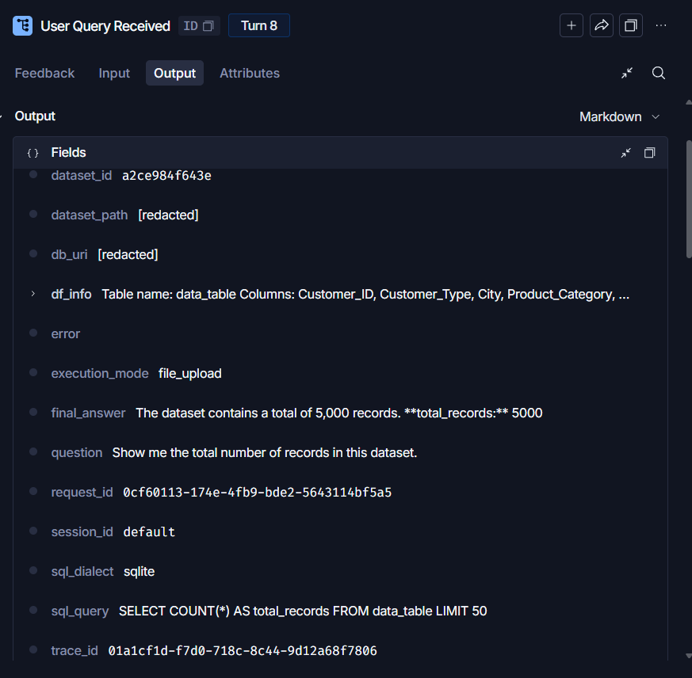
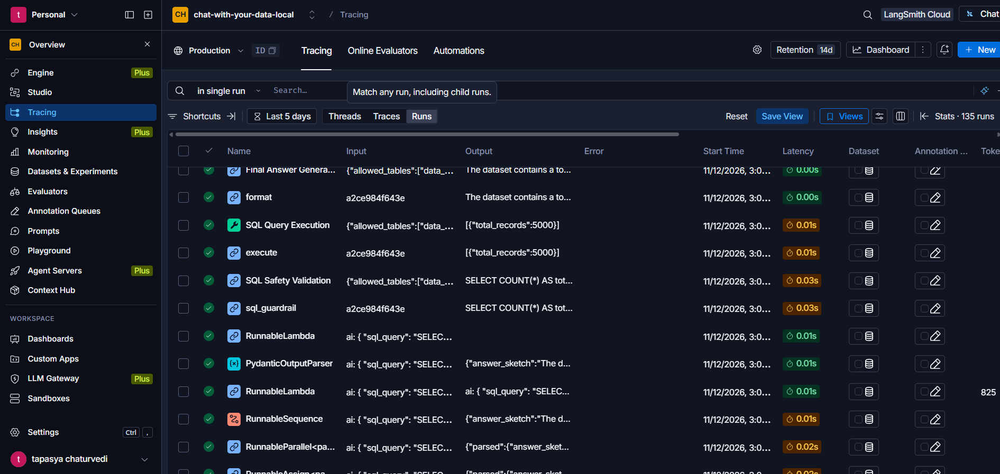

# Conversational Analytics Dashboard

Live demo: [data-chit-chat.vercel.app](https://data-chit-chat.vercel.app/)

Chat with your data using natural language. Upload a CSV, Excel, or JSON file, or
connect to a SQL Server database, then ask analytical questions without writing SQL or Python.

### Features

#### Data exploration
- Upload CSV, XLSX, and JSON datasets.
- Connect to a live SQL Server database with a SQLAlchemy connection string.
- Ask questions in plain English and receive a generated answer.
- Display query results as formatted tables.
- Automatically generate bar, line, pie, or scatter charts when a visualization helps explain the result.
- Export the conversation and insights as a PDF through the browser print dialog.

### Safety and privacy

- Detects prompt injection, jailbreak attempts, system commands, destructive SQL, and unrelated questions before query generation.
- Allows only single-statement, read-only `SELECT` queries against known tables.
- Sends only a small sample of the dataset to the LLM for schema analysis and query generation; data queries execute on the backend.
- Deletes uploaded files and their generated SQLite databases when the browser session ends.

### Observability and feedback

- Shows prompt, completion, reasoning, and total token usage when the provider returns usage metadata.
- Records LangSmith traces for the request and its LangGraph stages, including input validation, schema analysis, query generation, SQL validation, execution, response formatting, and output sanitization.
- Lets users upvote or downvote AI answers and optionally provide a reason.
- Stores one upserted feedback record per message in the Neon PostgreSQL `user_feedback` table.

---

### LLM benchmarking

The `LLM Benchmarking` directory contains the text-to-SQL evaluation workflow.
It builds a golden question set from IPL data covering 2021–2024 and compares
candidate models using the LLM-stats leaderboard as a reference:

- Grok 4.5
- Gemini 3.8 Flash
- GPT-5.6 Terra
- Kimi K3
- Claude Sonnet 5

### Technology stack

#### Frontend

- React
- Vite
- Tailwind CSS
- Recharts
- Axios

#### Backend

- FastAPI
- LangGraph and LangChain
- Google Gemini through `langchain-google-genai`
- Pandas
- SQLAlchemy
- SQLite for uploaded datasets
- SQL Server support through `pymssql`
- Neon PostgreSQL for answer feedback
- LangSmith for tracing

---

The production process is:

```text
gunicorn main:app --workers 1 --worker-class uvicorn.workers.UvicornWorker --bind 0.0.0.0:$PORT
```

#### Screenshots






